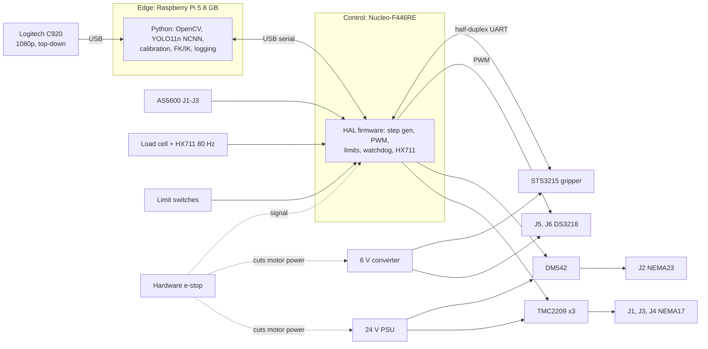

# FYP-I Requirements Spec and Architecture

Oct 24, 2026 · Sobaan Nasir · Approved by supervisor, Oct 24, 2026

Live version: https://claude.ai/artifact/NvZNqeaVeyQGVcbeSbycd8

## Scope

FYP-I delivers a working six-axis arm with a force-limited soft-pad gripper, preliminary egg detection on an edge device, and forward and inverse kinematics, within about 240,000 PKR.

- **In FYP-I:** arm built and moving from Python, gripper that stops at a force limit, e-stop, camera calibration, detector running live on the edge device.
- **Not in FYP-I:** autonomous egg handling and real-egg tests. Tests use foam balls, ping-pong balls and an egg-shaped dummy.
- **Designed for FYP-II now:** placement within 20 mm, localization error of 10 to 20 mm, grasp verification and slip detection, and fixed versus adaptive grip trials (30 + 30). Every choice below was checked against these so no hardware has to be replaced.

## Requirements

The arm reaches 45 cm and carries 250 g, with sensing and accuracy sized for the FYP-II targets.

| ID | Requirement | Target | Verified in |
| --- | --- | --- | --- |
| R1 | Reach | 45 cm from base axis | Week 8, FYP-I |
| R2 | Payload at full reach | 250 g (egg about 60 g plus gripper) | Week 2 torque calcs, Week 8 |
| R3 | Degrees of freedom | 6 (J1 to J6) plus two-finger gripper | Week 8, FYP-I |
| R4 | J2 shoulder torque | About 8 N·m including 50% margin (estimate, redo in Week 2) | Week 2 |
| R5 | Joint backlash, J1 to J3 | Gearboxes rated 20 arcmin or less | Week 4 and 5 |
| R6 | Joint feedback | AS5600 encoders on J1 to J3, homing with limit switches on all joints | Week 5 and 6 |
| R7 | Grip force | Measured by 1 kg load cell, read at 80 Hz; gripper stops at a set limit | Week 7 |
| R8 | Gripper feedback | Jaw position and load read back from the servo | Week 7 |
| R9 | Safety | Hardware e-stop cutting motor power, software stop, watchdog, joint and speed limits | Week 6, FYP-I |
| R10 | Perception | Egg detected live on the edge device from a fixed 1080p camera | Week 9, FYP-I |
| R11 | Localization | A few cm in FYP-I; 10 to 20 mm in FYP-II | Week 10, FYP-I |
| R12 | Budget | About 240,000 PKR total, 20,000 PKR held for spares and eggs | Week 2 BOM |

## Hardware selection

Geared steppers carry the heavy joints, servos keep the wrist light, and a Pi 5 runs vision on the edge. Costs are rough estimates until the Week 2 BOM.

| Subsystem | Choice | Why |
| --- | --- | --- |
| J1 base | NEMA17 stepper, about 10:1 low-backlash reduction | Enough torque, precise steps |
| J2 shoulder | NEMA23 stepper, 10:1 low-backlash planetary gearbox | Heaviest load, about 8 N·m needed |
| J3 elbow | NEMA17 stepper, about 15:1 low-backlash planetary gearbox | Second heaviest load |
| J4 wrist roll | Short NEMA17 or pancake stepper | Light, same driver type |
| J5, J6 wrist | DS3218 metal-gear servos | Keep wrist mass low |
| Joint encoders | AS5600 magnetic encoders on J1 to J3 | Catch missed steps, repeatable homing |
| Stepper drivers | TMC2209 (J1, J3, J4), DM542 (J2) | Strong driver only where needed |
| Controller | Nucleo-F446RE, STM32CubeIDE and HAL | Built-in debugger, enough timers, watchdog |
| Gripper motor | Feetech STS3215 smart servo | Position and load feedback, speed control |
| Force sensing | 1 kg load cell with HX711 (80 Hz) in one finger, FSR402 pads as backup | Accurate, linear, fast enough for slip detection |
| Camera | Logitech C920 at 1080p, fixed top-down, autofocus off | Cheap, works with any computer, stable calibration |
| Edge device | Raspberry Pi 5 8 GB with active cooler | YOLO11n at about 5 to 10 FPS on CPU, fits budget |
| Power | 24 V supply for steppers, separate 6 V converter for servos | Servos protected from stepper noise; sized in Week 2 |

Upgrade paths for FYP-II, no rework needed: AI HAT+ (Hailo-8L) on the same Pi for faster detection, OAK-D Lite if depth is ever needed.

## Architecture

The Pi turns camera images into joint targets and sends them over USB serial; the STM32 runs every motor and reads every sensor; the e-stop cuts motor power in hardware without waiting on software.

## Software, repo and open items

The Pi runs plain Python split into modules, so it could be wrapped in ROS 2 later if ever needed.

- **Pi:** Raspberry Pi OS 64-bit, Python 3, OpenCV, Ultralytics YOLO11n exported to NCNN, NumPy, pyserial. Own FK and IK, checked against roboticstoolbox-python.
- **STM32:** STM32CubeIDE with HAL. Step generation, servo PWM, limit switches, e-stop, HX711, STS3215, watchdog.
- **Repo:** one GitHub repo with `firmware/`, `pi/`, `cad/`, `docs/`, `data/logs/`. Datasets on Google Drive or Roboflow.
- **Task board:** GitHub Projects, one column per track (A, B, C), one issue per roadmap task.
- **Labelling:** Roboflow free tier, YOLO export.

Open items for Week 2:

- [ ] Sketch the J1 to J6 layout and draft link lengths (Tracks A and C agree)
- [ ] Redo J2 and J3 worst-case torque from draft CAD
- [ ] Power budget: size the 24 V supply and 6 V converter
- [ ] Costed BOM with local and import prices; order long-lead parts (gearboxes, motors)
- [x] Create the GitHub repo and task board
- [x] Supervisor sign-off on this spec
